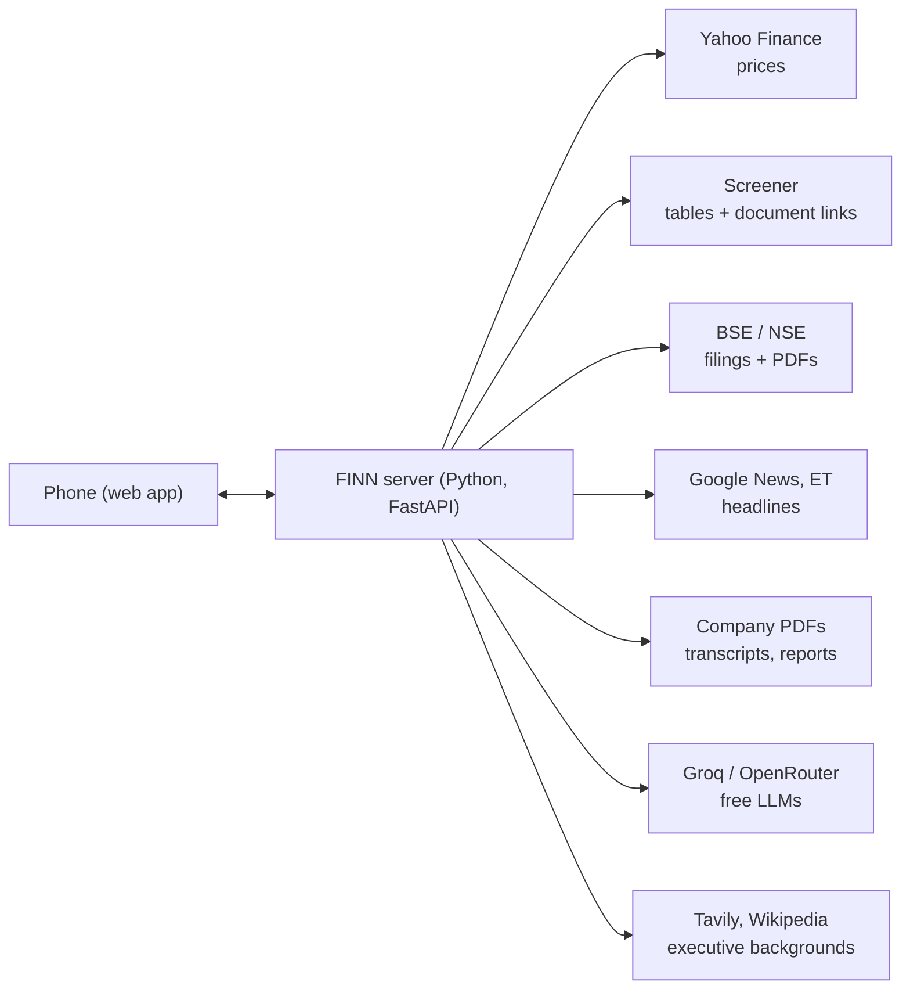

# FINN — Financial Investment Agent

A phone-first app that tells an investor what changed in their portfolio today, and lets them dig into any NSE company using only the company's own documents. Built for the ENAM Holdings AI Engineer Build Challenge (Nov 2026).

**Live app:** [your Render link] · open it on a phone and use "Add to Home Screen"
**AI build history:** [link to chat exports]

---

## What it does

**Briefing (Push).** Everything that happened across your portfolio in the last 24 hours, 3 days or 7 days, sorted by what matters:

- **Market moves**: price or volume beyond the thresholds *you* set (default ±5% and 2× the 20-day average volume), including today's move while the market is open.
- **Results**: Revenue, EBITDA, PBT and PAT, QoQ and YoY, read from the actual results filing and cross-checked against Screener.
- **Management changes**: who is coming in, who is leaving, and a short, sourced background of the new person.
- **Deals, legal, ratings and other material filings**: one-line summaries written from the filed PDF.
- **Routine paperwork** is folded away. **Listen** reads the briefing aloud, starting with market moves.

**Research (Pull).** Works for **any NSE company**, not just the demo list. FINN reads the company's last four call transcripts, latest investor presentation and annual report, and builds a report in tabs: Summary, Business, Promises, Drivers, Numbers, Cash & debt, Bull & bear, Sources.

- **Promises** is the centrepiece: guidance from each call (e.g. "12–14% revenue growth in FY27"), checked in code against the quarters reported afterwards → Beat / Delivered / On track / Behind / Missed / Too early.
- **Every sentence is cited.** Tap the `[1]` to see the exact passage and page, with a link to the PDF.
- **Ask** anything by typing or by voice. Follow-ups ("why?") understand the previous question; small talk and off-topic questions get a polite redirect instead of made-up answers.

**Portfolio.** Search any NSE/BSE stock to open its page (price, results, ratios, news, filings, documents). **Edit** has two buttons: Add and Delete. The briefing updates within seconds.

## How it works



1. **Fetch (stage 1, seconds):** prices for all stocks in one request; Screener pages, BSE filings and news in parallel (each website limited to ~3 requests a second). The briefing appears as soon as this is done.
2. **Read (stage 2, background):** results PDFs, one-line filing summaries and executive backgrounds fill in without blocking the screen.
3. **Research:** numbers are computed first (shown in seconds), PDFs are downloaded in parallel and read page by page, the most relevant passages are found with keyword search (BM25), and the LLM writes each section from those passages only.
4. **Check:** every LLM sentence must cite a source it was given, and every number in it must appear in that source. Anything else is deleted before it reaches the screen.

The server refreshes every 10 minutes while it is awake. Data is kept in a local SQLite cache.

## Data sources (all free)

| Source | Used for | Notes |
|---|---|---|
| Yahoo Finance (yfinance) | Daily and in-session prices, volume | In-session prices can lag ~15 min |
| BSE announcements (bseindia.com's own JSON) | Every filing per company, with its PDF | Undocumented endpoint; schema-checked; FINN stops if it changes |
| NSE RSS feed | Recent filings | NSE's per-company JSON returns 403 and is not worked around |
| Screener.in | Financial tables, BSE codes, links to transcripts and reports | Numbers only, always labelled |
| Company PDFs (BSE / company websites) | Research text, results numbers, filing summaries | Primary documents only |
| Google News RSS, Economic Times RSS | Headlines from trusted outlets | Labelled as news; never used in Research |
| Tavily, Wikipedia | Background of incoming executives | Push only, as the brief allows |
| Groq, OpenRouter | LLM writing and extraction | Free tiers |

## Key decisions and trade-offs

- **The LLM never does arithmetic.** It copies or writes; code calculates every number (growth, margins, debt-to-equity, cash ÷ profit, QoQ/YoY, promise verdicts). Slower to build, but nothing invented reaches the screen.
- **Research uses only primary sources**, as the brief asks: no news, no broker notes, no model background knowledge. The prompts say so and a validator enforces it.
- **Free tiers only.** Small jobs (guidance extraction, filing summaries, results numbers) go to smaller models; reasoning goes to larger ones. Calls are paced to each model's per-minute limit, cached, and retried once if a limit is hit. *Trade-off:* Render's free server sleeps after 15 idle minutes, so the first open after a quiet spell is slower.
- **Keyword search, not a vector database.** Free, fast, deterministic and strong on exact terms like "EBITDA" or "FY27". *Trade-off:* it can miss synonyms.
- **Two-stage refresh.** The briefing shows as soon as prices, filings and news are in; PDF reading continues in the background.
- **One web app instead of native apps.** Works on any phone, installs to the home screen, and the backend serves it, so there is one thing to deploy.

## Deliberately left out

- **LinkedIn scraping:** against LinkedIn's terms. Filings, web search and Wikipedia cover backgrounds.
- **Anything behind a login, CAPTCHA or block:** NSE's JSON returns 403 and FINN doesn't work around it.
- **User accounts and multi-user portfolios:** one shared demo portfolio.
- **Push notifications to the phone:** alerts show in the app.
- **OCR for scanned PDFs:** scanned filings show their subject and link only.

## Where I'd take it next

1. Phone notifications when an alert fires.
2. A database that survives restarts, so history and research persist.
3. OCR for scanned filings.
4. Guidance tracking over several years, and peer comparison.
5. Per-user portfolios and settings.

## Run it locally

Python 3.10+.

```bash
cd backend
pip install -r requirements.txt
python -m uvicorn finn.api:app --port 8000
```

Open http://localhost:8000. For the phone view use Chrome DevTools (F12 → Ctrl+Shift+M).

**Keys (all free):** copy `.env.example` to `.env` in the repo root and fill in what you have. `.env` is git-ignored; never commit it.

| Key | Where to get it | Turns on |
|---|---|---|
| `GROQ_API_KEY` | console.groq.com → API Keys | Research writing, results numbers, summaries, bios |
| `OPENROUTER_API_KEY` | openrouter.ai → Keys | Backup LLM when Groq is busy |
| `TAVILY_API_KEY` | app.tavily.com | Web search for executive backgrounds |

Without keys, prices, filings, news, numbers and the document list still work; the written sections say they need a key.

**Useful commands**

```bash
python -m pytest                     # 187 offline tests (no network)
python -m finn check-live            # one real call per data source
python -m finn check-llm             # checks each configured model and key
python -m finn research ASTRAL       # builds a research report in the terminal
FINN_DATA_MODE=fixture python -m uvicorn finn.api:app --port 8000   # demo mode: invented companies, no internet
```

Browser checks (Playwright): `design/prototype/test/v3.cjs` (screens, multi-tap, research flows) and `test/buttons.cjs` (taps every button on every screen).

## Deploy (Render, free)

1. Push this repo to GitHub.
2. On render.com: **New + → Blueprint**, pick the repo; it reads `render.yaml` and the `Dockerfile`.
3. Paste `GROQ_API_KEY`, `OPENROUTER_API_KEY` and `TAVILY_API_KEY` when asked.
4. Optional: point a free UptimeRobot monitor at `https://<your-app>.onrender.com/health` every 5 minutes so the server stays awake and fast.

Every `git push` redeploys automatically.

## Repository layout

| Path | What it is |
|---|---|
| `backend/finn/api.py` | HTTP API; also serves the web app |
| `backend/finn/pipeline.py` | Fetching (two stages, parallel) and the briefing |
| `backend/finn/providers/` | Yahoo, BSE/NSE, Screener, news, search adapters |
| `backend/finn/classify.py`, `rank.py`, `market.py` | Filing categories, ranking, price/volume alerts |
| `backend/finn/filings.py` | Results numbers and one-line summaries from filed PDFs |
| `backend/finn/people.py` | Incoming-executive backgrounds |
| `backend/finn/research/` | Documents, retrieval, numbers, prompts and validator, promises ledger, research engine |
| `backend/finn/llm.py` | Free-model routing, pacing, caching |
| `backend/config/` | Portfolio (20 holdings + 4 research companies), alert thresholds, sources |
| `backend/tests/` | Offline tests with invented "Fixture …" companies |
| `design/prototype/` | The web app (HTML, CSS, JavaScript) and browser tests |
| `docs/` | Requirements, product spec, architecture, decision log, progress |

## Docs

[Product spec](docs/PRODUCT_SPEC.md) · [Architecture](docs/ARCHITECTURE.md) · [Decisions](docs/DECISIONS.md) · [Progress](docs/PROGRESS.md) · [Requirements](docs/REQUIREMENTS.md) · [Research notes](docs/RESEARCH.md)

---

*Personal, non-commercial prototype. Not investment advice. Data belongs to its sources and is linked back to them.*
