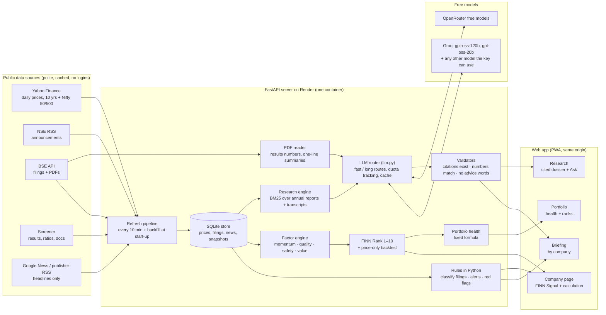

# FINN — how it is built

**Rule of the system:** numbers, ranks, flags and health are computed in Python. Models only locate or reword
facts they are given, and every model output is checked (cited ids must exist, every % and ₹ must match the
data, no advice or prediction words) before it is shown; otherwise a rule-based text is shown instead.
